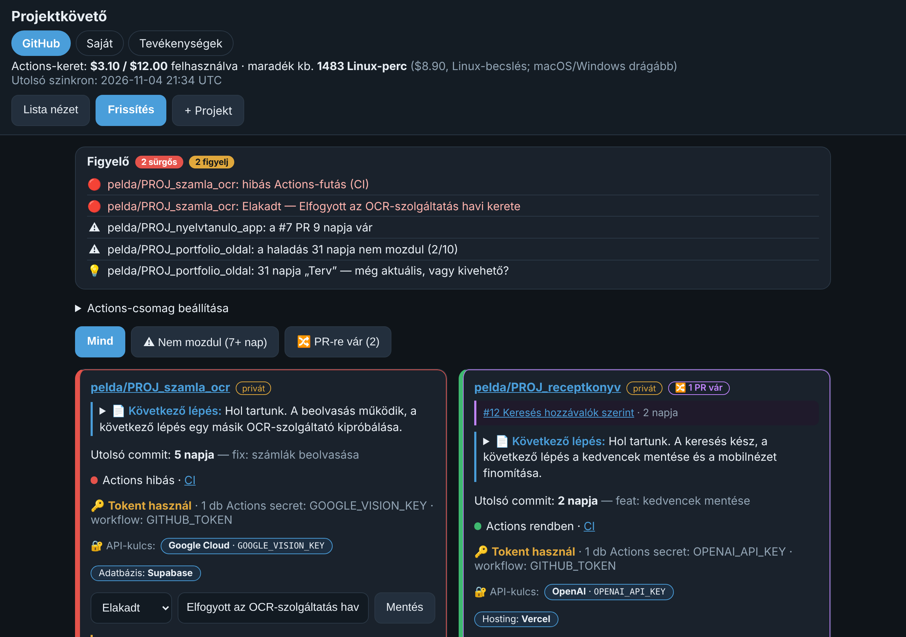
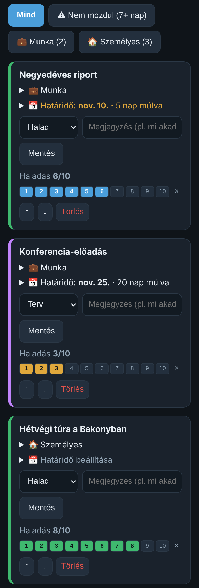
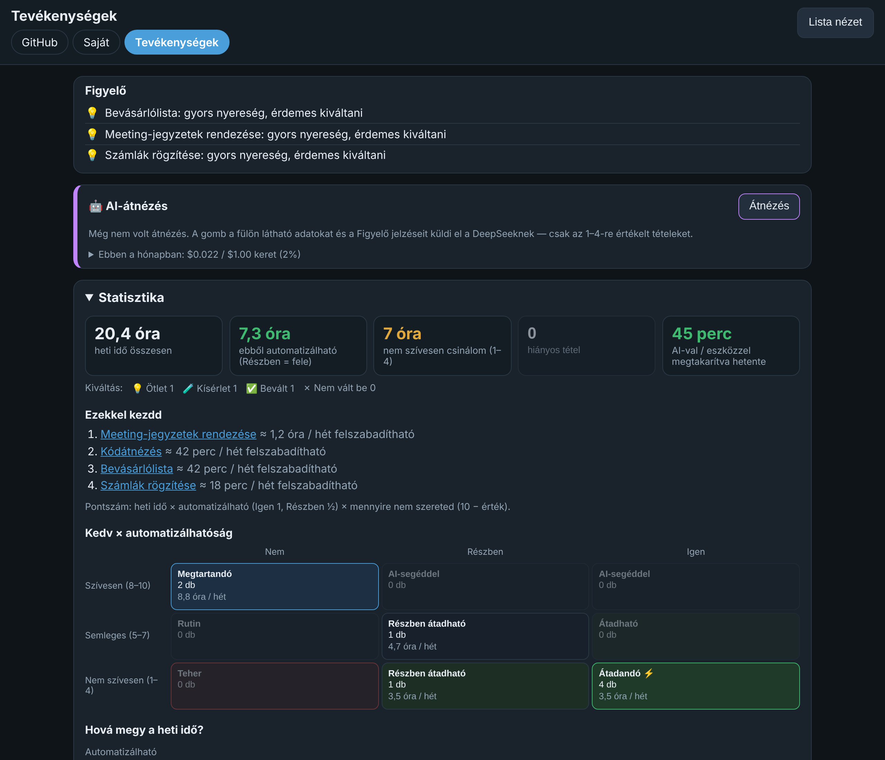
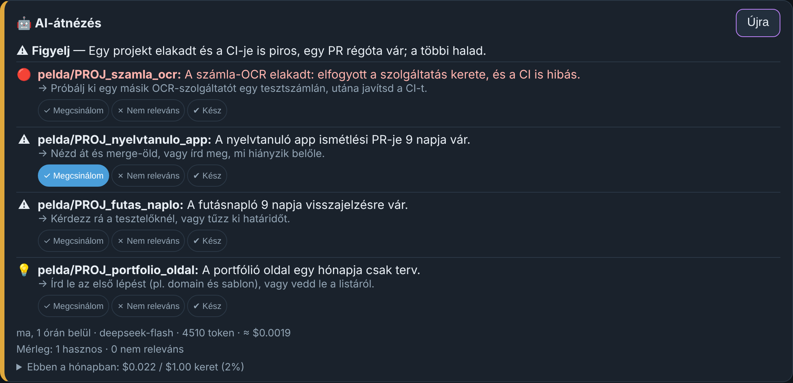
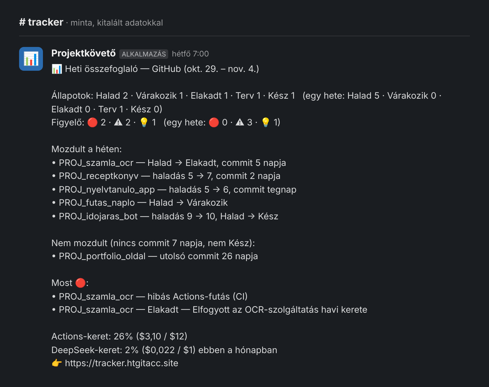

# Projektkövető — személyes állapotfal a futó projektekhez

*Egy oldal, ahol egy pillantással látszik, melyik projekt halad, melyik akadt
el, és mivel érdemes ma foglalkozni — GitHub-projektekhez, saját teendőkhöz és
a mindennapi feladatokhoz.*

> **Ez egy bemutató repó.** A Projektkövető forráskódja privát repóban van;
> itt a működését mutatom be a felületéről készült képekkel. A képeken
> **kitalált demó adatok** szerepelnek.
>
> Élőben fut: **https://tracker.htgitacc.site** — jelszóval védett, mert
> személyes használatra készült.

---

## Mire való?

Aki egyszerre több projekten dolgozik, könnyen elveszíti a fonalat: melyik
áll már hetek óta, hol vár egy jóváhagyás, melyik határidő közeleg, és mi
romlott el éjszaka. Az információ szét van szórva — a GitHubon, jegyzetekben,
a fejben.

A Projektkövető ezt egy helyre gyűjti, és **magától szól**, ha valamire
figyelni kell. Telefonon is kényelmesen használható, magyar nyelvű, és
naponta frissül.

## Mit tud?

- **Három nézet:** GitHub-projektek, saját (nem kódos) projektek — munka vagy
  személyes, határidővel —, és a napi tevékenységek.
- **Kézi állapot és haladás:** Terv, Halad, Várakozik, Elakadt, Kész, rövid
  megjegyzéssel és egy 1–10-es haladásjelzővel.
- **Figyelő:** szabályok alapján jelzi, ami biztosan figyelmet kér — hibás
  automatikus teszt, elakadt projekt, régóta váró jóváhagyás, közelgő vagy
  lejárt határidő.
- **AI-átnézés gombnyomásra:** egy nyelvi modell átnézi az adatokat, és
  legfeljebb öt konkrét javaslatot ad, mindegyikhez egy következő lépéssel.
  A javaslatokra visszajelzés adható, és a következő átnézés ezt figyelembe
  veszi.
- **Tevékenységek elemzése:** mennyi időt visz el egy-egy feladat hetente, mi
  automatizálható, mit csinálok nem szívesen — és mennyi időt takarít meg egy
  kipróbált eszköz.
- **Értesítés és heti összefoglaló Slackre:** reggel szól, ha új sürgős
  jelzés van, hétfőn pedig összefoglalja, mi mozdult a héten.

## Végig a felületen

### 1. A GitHub-projektek fala

Felül a Figyelő: a piros sorok sürgősek, a sárgák figyelmeztetések, a
villanykörte tipp. Alatta a projektek kártyái: mikor volt az utolsó
módosítás, sikeres-e az automatikus ellenőrzés, vár-e jóváhagyásra valami,
milyen külső szolgáltatást használ — és a projekt saját leírásából kiolvasott
„következő lépés”. A kártya bal szélének színe az állapotot mutatja.

### 2. Saját projektek telefonon

A nem kódos projektek — riport, előadás, túra, felújítás — ugyanígy
követhetők. Megadható, hogy munka vagy személyes, és lehet határidő is; a
közelgő határidő színnel kiemelve jelenik meg. A felület elsősorban
telefonra készült.

### 3. Tevékenységek: hová megy az idő?

A napi feladatok listájából a program kiszámolja a heti időigényt, és
megmutatja, mit érdemes kiváltani: ami sok időt visz, automatizálható, és
amúgy sem szívesen csinálom. A kipróbált megoldások (például egy
AI-összefoglaló) megtakarítása is látszik.

### 4. AI-átnézés

Gombnyomásra a modell átnézi a fül adatait, és rövid, konkrét javaslatokat
ad. Minden pont mellett jelölhető, hogy „Megcsinálom”, „Nem releváns” vagy
„Kész”. Alul látszik a költség is: egy átnézés a cent töredéke, és van havi
keret.

### 5. Heti összefoglaló

Hétfő reggel egy rövid, szabályalapú összefoglaló érkezik a csapatcsatornába:
állapotok most és egy hete, mi mozdult, mi nem, mi sürgős, és mennyi a
havi keretekből.

## Mit mutat ez a munka?

- **Valós problémából működő termék:** a saját napi munkám zavaró pontjaiból
  indult, és kis lépésekben, mindig a használat visszajelzése alapján
  bővült.
- **Felhasználóközpontú felület:** magyar nyelv, telefonra tervezett
  elrendezés, egyértelmű színek és rövid, érthető üzenetek.
- **Felelős AI-használat:** a biztos jelzéseket egyszerű szabályok adják;
  a nyelvi modell csak súlyoz és javasol, gombnyomásra, költségkerettel.
- **Biztonság és adatkezelés:** jelszavas belépés, a titkos kulcsok soha nem
  kerülnek a kódba vagy a naplóba; napi biztonsági mentés.
- **Üzemeltetés:** saját szerveren fut, automatikus napi frissítéssel,
  értesítéssel, dokumentált telepítési és karbantartási lépésekkel.
- **Minőség:** több mint száz automatikus teszt, amely valódi külső
  szolgáltatás hívása nélkül ellenőrzi a működést.

## Amit ez a bemutató nem állít

- Ez egy személyes, egyfelhasználós eszköz, nem többfelhasználós termék.
- A képek kitalált demó adatokkal készültek; a valódi projektek és számok
  nem nyilvánosak.

## Technológia röviden

- Python, FastAPI, Jinja2 sablonok, SQLite — külön build lépés és
  JavaScript-keretrendszer nélkül
- GitHub REST API (commitok, automatikus tesztek, jóváhagyásra váró
  változtatások, havi keret)
- DeepSeek nyelvi modell az AI-átnézéshez, JSON-válasz ellenőrzéssel
- Slack Incoming Webhook az értesítéshez és a heti összefoglalóhoz
- Ubuntu-szerver: systemd szolgáltatás, Caddy (HTTPS), ütemezett feladatok
- Automatikus tesztek: egység-, regressziós és végponttól végpontig tartó
  tesztek, hamis külső szolgáltatásokkal

## Több részlet kérésre

A forráskód privát repóban van. Aki a felépítést, a fejlesztés menetét vagy
a kódot részletesebben is látná, annak szívesen megmutatom.

Fejlesztői profil: [github.com/htgitacc](https://github.com/htgitacc)
